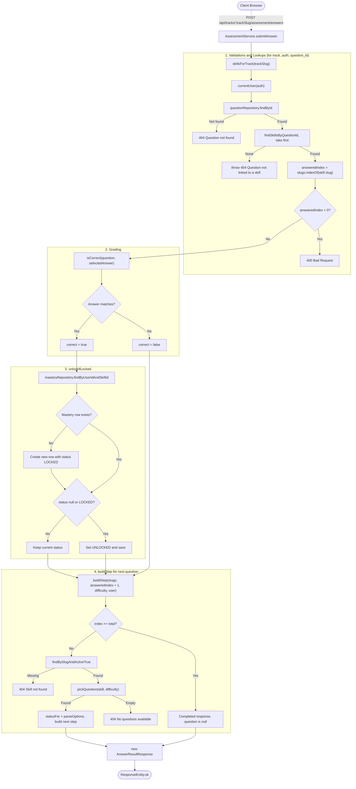

# Assessment Architecture

## Overview (In Simple Points)

1. **Fixed Skill Sequence per Track**: Each track (currently `backend-development`) maps to an ordered list of **12 core skills** in `AssessmentService`.
2. **Authentication Required**: Both starting an assessment and submitting answers require a valid JWT (`currentUser(auth)` returns `401 Unauthorized` if the user is not logged in).
3. **Starting the Assessment (`GET /api/tracks/{trackSlug}/assessment/start`)**:
   - Looks up the 12-skill list for the requested `trackSlug`.
   - Normalizes the requested `difficulty` (`BEGINNER`, `MEDIUM`, or `HARD`, defaulting to `BEGINNER`).
   - Loads the first skill (`index = 0`), picks a random matching question (falling back to any difficulty for that skill if none match), checks the user's current skill status (`LOCKED` / `UNLOCKED`), and returns `AssessmentStepResponse`.
4. **Submitting an Answer (`POST /api/tracks/{trackSlug}/assessment/answers`)**:
   - **Step 1 — Validation & Lookups**: Verifies the track, authenticates the user, fetches the `questionId` (`404` if missing), resolves its linked skill (`404` if unlinked), and finds the skill's position (`answeredIndex`) in the track's assessment list (`400` if it does not belong to the track).
   - **Step 2 — Grading**: Compares `selectedAnswer` with `question.correctAnswer` (trimmed, case-insensitive) to set `correct = true` or `false`.
   - **Step 3 — Skill Unlocking**: If `correct == true`, calls `unlockIfLocked(user, skill)`. If the user has no `user_skill_mastery` row for that skill yet, it creates one; if the status is `null` or `LOCKED`, it updates the status to `UNLOCKED` and saves it.
   - **Step 4 — Next Question / Completion**: Builds the next step at `answeredIndex + 1`:
     - If `index >= 12`, returns `completed = true` with `question = null` and `"Assessment completed successfully."`.
     - Otherwise, loads the next active skill and picks a question for it, returning `AnswerResultResponse` (`correct`, `correctAnswer`, `explanation`, and `next`).

---

## Answer Submission Flow (`AssessmentService.submitAnswer`)

