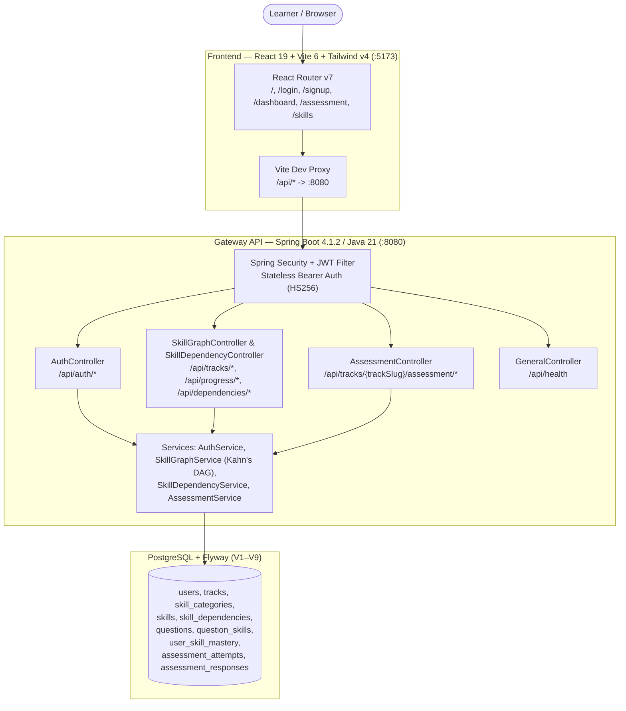
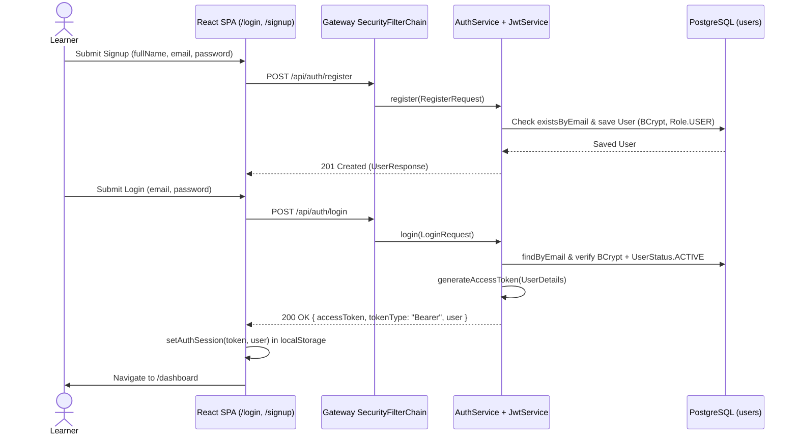
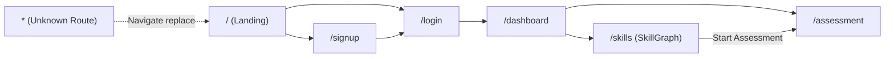
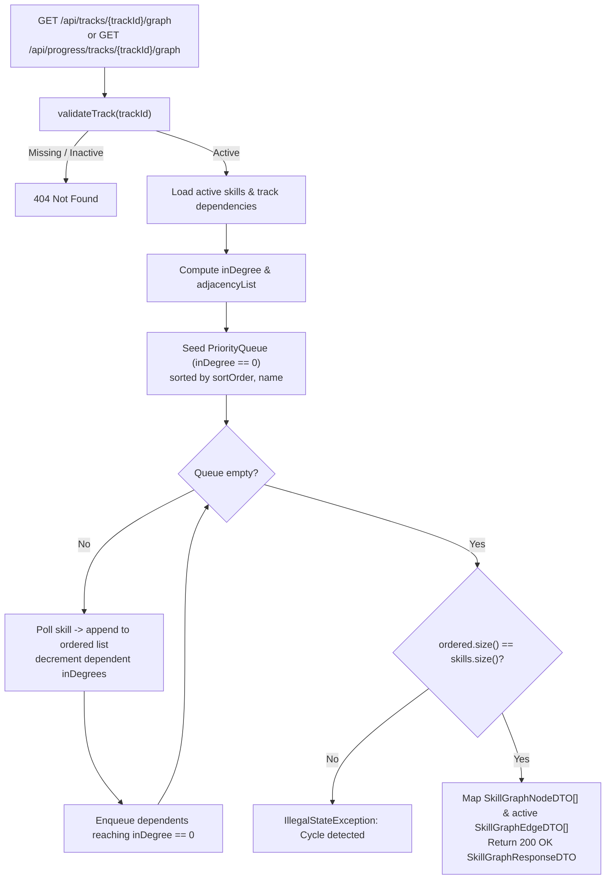
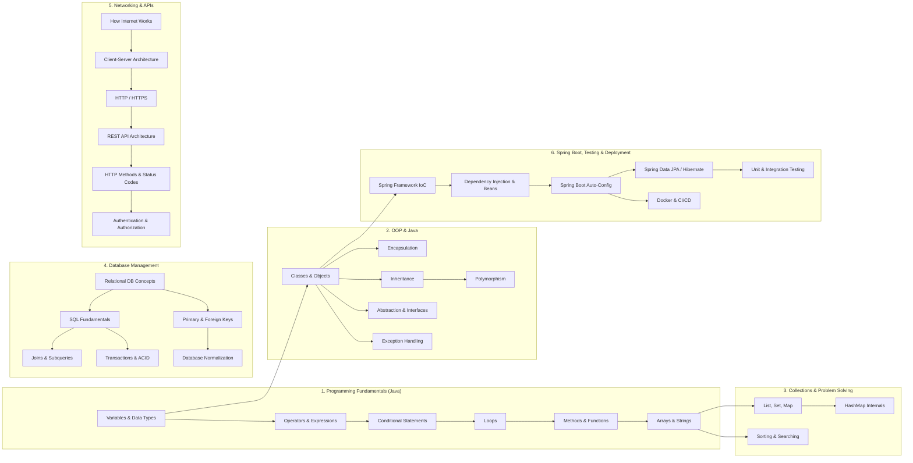
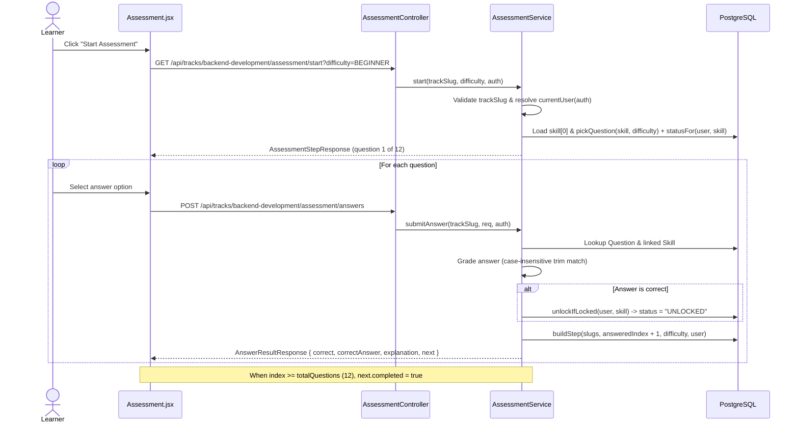
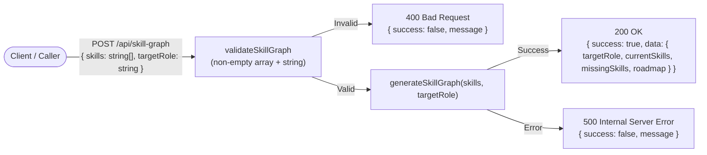
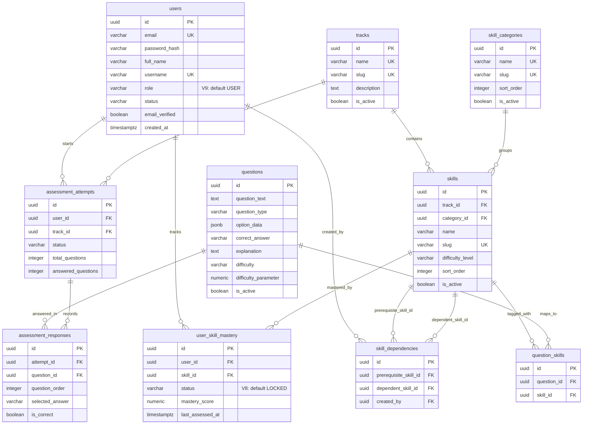

# octoByte — AI Upskilling Platform (v2.0)

An adaptive technical upskilling platform that maps learner proficiency across a structured **Skill Directed Acyclic Graph (DAG)**, evaluates knowledge through **step-by-step assessments**, tracks **skill unlock and mastery state** in PostgreSQL, and includes an **Async AI Skill-Graph Microservice** for target-role gap analysis.

---

## Table of Contents

- [System Architecture](#system-architecture)
- [Repository Structure](#repository-structure)
- [Core Workflows & Diagrams](#core-workflows--diagrams)
  - [1. Authentication & Frontend Routing Flow](#1-authentication--frontend-routing-flow)
  - [2. Skill DAG Architecture & Topological Resolution](#2-skill-dag-architecture--topological-resolution)
  - [3. Adaptive Assessment & Skill Unlock Flow](#3-adaptive-assessment--skill-unlock-flow)
  - [4. Async AI Skill-Graph Microservice Flow](#4-async-ai-skill-graph-microservice-flow)
- [Database Schema (ER Diagram)](#database-schema-er-diagram)
- [Tech Stack](#tech-stack)
- [API Reference](#api-reference)
- [Local Setup & Running](#local-setup--running)
- [Testing](#testing)
- [Related Documentation](#related-documentation)

---

## System Architecture

The core platform connects the React frontend, Spring Boot gateway, and PostgreSQL:



---

## Repository Structure

```text
Upskilling-Platform-v2.0/
├── Readme.md
├── package.json
├── Documentation/
│   ├── Frontend/
│   │   ├── Auth.png
│   │   └── flowFrontend.png
│   └── Gateway/
│       └── AssessmentArchitecture.md
├── frontend/                           # React 19 + Vite 6 + Tailwind CSS v4 SPA
│   ├── vite.config.js                  # Proxies /api -> http://localhost:8080
│   ├── .env.example                    # VITE_API_BASE_URL=http://localhost:8080/api
│   └── src/
│       ├── App.jsx                     # Route definitions
│       ├── api/
│       │   ├── config.js               # API_BASE_URL resolution
│       │   └── auth.js                 # localStorage JWT & user session helpers
│       └── components/
│           ├── landing/Landing.jsx
│           ├── auth/Login.jsx & Signup.jsx
│           ├── dashboard/Dashboard.jsx
│           ├── assessment/Assessment.jsx
│           └── skillgraph/SkillGraph.jsx
├── gateway/                            # Java 21 + Spring Boot 4.1.2 REST Gateway
│   ├── pom.xml
│   ├── FRONTEND_GATEWAY_API_DOCS.md
│   └── src/main/
│       ├── java/com/aiupskillingplatform/
│       │   ├── controllers/            # General, auth, dag, IrtAssessment
│       │   ├── dto/                    # auth, dag, assessment DTOs
│       │   ├── entities/               # JPA entities
│       │   ├── enums/                  # Role (USER, ADMIN), UserStatus
│       │   ├── repositories/           # Spring Data JPA repositories
│       │   ├── security/               # SecurityConfig, JwtAuthenticationFilter, CustomUserDetailsService
│       │   └── services/               # auth, dag, assessment business logic
│       └── resources/
│           ├── application.properties
│           ├── .env.example
│           └── db/migration/           # Flyway SQL migrations V1 through V9
└── AsyncFunctions/                     # Express 5 microservice for AI roadmap generation
    ├── package.json
    └── src/
        ├── app.js                      # Express app & /api/skill-graph endpoint (:3000)
        ├── middlewares/validateSkillGraph.js
        └── services/aiService.js
```

---

## Core Workflows & Diagrams

### 1. Authentication & Frontend Routing Flow

Registration assigns `Role.USER` (`UserStatus.ACTIVE`) with BCrypt (cost 12) password hashing. Login issues a signed HS256 JWT (`jwt.expiration-ms`, default `86400000` ms / 24 hours). The frontend stores the token and user profile in `localStorage` (`token` and `user`) and attaches `Authorization: Bearer <token>` on authenticated API calls.



#### Frontend Route Map



---

### 2. Skill DAG Architecture & Topological Resolution

The `backend-development` track (`10000000-0000-0000-0000-000000000001`) is seeded via Flyway migrations (`V2`–`V5`) with **6 categories**, **33 active skills**, and **30 directed prerequisite edges**.

`SkillGraphService` validates that the track exists and is active, then computes a deterministic topological order using **Kahn's algorithm** backed by a `PriorityQueue` ordered by `(sortOrder, name)`. `SkillDependencyService` guards against self-dependencies, cross-track edges, duplicates, and cycles (via BFS `hasPath`).



#### Seeded `backend-development` DAG Overview (`V3`–`V5`)



---

### 3. Adaptive Assessment & Skill Unlock Flow

`AssessmentController` exposes `GET /api/tracks/{trackSlug}/assessment/start` and `POST /api/tracks/{trackSlug}/assessment/answers`. Although `/api/tracks/**` passes the Spring Security URL matcher, `AssessmentService.currentUser(auth)` enforces an authenticated user (`401 UNAUTHORIZED` for anonymous requests).

For `backend-development`, the assessment evaluates a curated **12-skill sequence**:
1. `variables-data-types` → `classes-objects` → `list-set-map` → `relational-database-concepts` → `how-internet-works` → `spring-framework-ioc` → `operators-expressions` → `encapsulation` → `hashmap-internals` → `sql-fundamentals` → `client-server-architecture` → `dependency-injection-spring-beans`



**How the assessment works (in simple steps):**
1. **Start**: Client calls `GET /api/tracks/{trackSlug}/assessment/start?difficulty=BEGINNER`. The service authenticates the JWT user, loads the first skill in the 12-skill track list, and picks a random question matching the difficulty (or any available question for that skill if none match).
2. **Validate & Lookup**: On `POST /api/tracks/{trackSlug}/assessment/answers`, the service verifies the track, authenticated user, `questionId`, and that the question's linked skill belongs to the track's assessment sequence.
3. **Grade & Unlock**: It compares `selectedAnswer` with `correctAnswer` (case-insensitive, trimmed). If correct, `unlockIfLocked` sets the user's `user_skill_mastery.status` for that skill from `LOCKED` (or new row) to `UNLOCKED`.
4. **Advance or Finish**: It builds the next question at `answeredIndex + 1` and returns feedback (`correct`, `correctAnswer`, `explanation`) plus `next`. After question 12, `next.completed` is `true` and `next.question` is `null`.

> For the detailed internal flowchart and step-by-step breakdown of `AssessmentService.submitAnswer`, see [Documentation/Gateway/AssessmentArchitecture.md](Documentation/Gateway/AssessmentArchitecture.md).

---

### 4. Async AI Skill-Graph Microservice Flow

The `AsyncFunctions` Node.js/Express 5 service runs independently on port `3000` and exposes `POST /api/skill-graph` to generate a skill-gap roadmap for a target role. *(Note: `aiService.js` currently returns a deterministic stubbed roadmap while the AI provider integration is built out.)*



---

## Database Schema (ER Diagram)

Schema and seed data are managed exclusively by Flyway (`spring.jpa.hibernate.ddl-auto=none`) in `gateway/src/main/resources/db/migration/V1__initial_schema.sql` through `V9__add_role_to_users.sql`.



---

## Tech Stack

| Layer | Technologies |
| :--- | :--- |
| **Frontend** | React 19, Vite 6, React Router DOM v7, Tailwind CSS v4, Lucide React, Vitest + Testing Library |
| **Gateway API** | Java 21, Spring Boot 4.1.2, Spring WebMVC, Spring Security, Spring Data JPA, JJWT `0.12.6`, Lombok |
| **Database & Migrations** | PostgreSQL, Flyway (`V1`–`V9`) |
| **Async Microservice** | Node.js, Express 5.3, CORS, dotenv |

---

## API Reference

### Gateway (`http://localhost:8080`)

| Method | Endpoint | Auth / Role | Purpose |
| :--- | :--- | :--- | :--- |
| `GET` | `/api/health` | Public | Returns `"The server is live"` |
| `POST` | `/api/auth/register` | Public | Register a new user (`Role.USER`) |
| `POST` | `/api/auth/login` | Public | Authenticate user and return Bearer JWT |
| `GET` | `/api/tracks/{trackId}/graph` | Public | Topologically sorted skill DAG nodes & edges |
| `GET` | `/api/progress/tracks/{trackId}/graph` | Authenticated (`JWT`) | Skill DAG endpoint requiring authentication |
| `GET` | `/api/dependencies/skills/{skillId}/prerequisites` | Authenticated (`JWT`) | List active prerequisite skills for a skill |
| `GET` | `/api/tracks/{trackSlug}/assessment/start` | Authenticated (`JWT` in service) | Start assessment (`?difficulty=BEGINNER\|MEDIUM\|HARD`) |
| `POST` | `/api/tracks/{trackSlug}/assessment/answers` | Authenticated (`JWT` in service) | Grade answer, unlock skill if correct, return next step |

### AsyncFunctions (`http://localhost:3000`)

| Method | Endpoint | Purpose |
| :--- | :--- | :--- |
| `GET` | `/` | Health greeting (`"Hello World"`) |
| `POST` | `/api/skill-graph` | Validate `{ skills, targetRole }` and return missing skills + roadmap |

---

## Local Setup & Running

### Prerequisites
- **Java 21** (Maven Wrapper included in `gateway/`)
- **PostgreSQL** running locally (e.g., port `5432`)
- **Node.js** (v18+ recommended) and **npm**

### 1. Database & Gateway (`gateway/`)

1. Create a PostgreSQL database (default in `application.properties`: `upskill2`; `.env.example` uses `ai_upskilling`).
2. Copy the environment template and configure your credentials and Base64 JWT secret (>= 32 bytes for HS256):
   ```bash
   cp gateway/src/main/resources/.env.example gateway/src/main/resources/.env
   ```
   Key variables:
   - `SERVER_PORT=8080`
   - `DB_URL`, `DB_USERNAME`, `DB_PASSWORD`
   - `JWT_SECRET`, `JWT_EXPIRATION_MS=86400000`
   - `CORS_ALLOWED_ORIGINS=http://localhost:*,http://127.0.0.1:*`
   - `DAG_MASTERY_THRESHOLD=0.75`
3. Start the Spring Boot gateway (Flyway automatically runs `V1`–`V9` on startup):
   ```bash
   cd gateway
   ./mvnw spring-boot:run    # Windows PowerShell: .\mvnw.cmd spring-boot:run
   ```

### 2. Frontend (`frontend/`)

1. Configure environment variables:
   ```bash
   cp frontend/.env.example frontend/.env
   ```
   (`VITE_API_BASE_URL=http://localhost:8080/api`, or rely on Vite's `/api` proxy in `vite.config.js`).
2. Install dependencies and start the dev server:
   ```bash
   cd frontend
   npm install
   npm run dev
   ```
   Open `http://localhost:5173`.

### 3. Async AI Microservice (`AsyncFunctions/`)

```bash
cd AsyncFunctions
npm install
npx nodemon src/app.js   # or: node src/app.js
```
Runs on `http://localhost:3000`.

---

## Testing

- **Gateway unit/controller tests**:
  ```bash
  cd gateway
  ./mvnw test              # Windows PowerShell: .\mvnw.cmd test
  ```
- **Frontend tests & lint**:
  ```bash
  cd frontend
  npm test
  npm run lint
  ```

---

## Related Documentation

- [Assessment Architecture Flowchart](Documentation/Gateway/AssessmentArchitecture.md)
- [Gateway API Documentation](gateway/FRONTEND_GATEWAY_API_DOCS.md)

